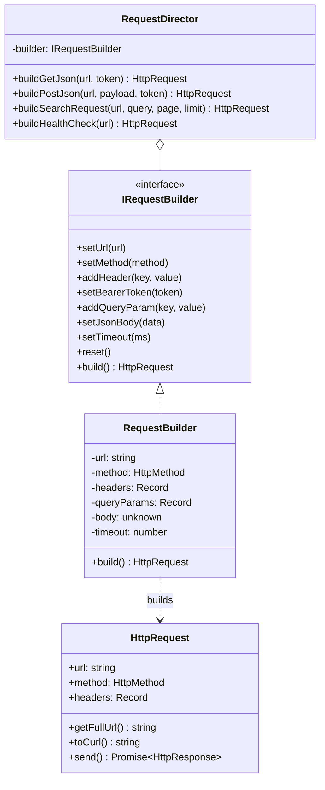

# Task 3: Builder Pattern (HTTP Request Builder in TypeScript) 🌐🏗

Ushbu vazifada **GoF Builder (Quruvchi)** dizayn andozasi asosida murakkab HTTP so'rovlarini bosqichma-bosqich qulay va xavfsiz shakllantiruvchi hamda ularni yuboruvchi **Request Builder** tizimi ishlab chiqildi.

---

## 🛑 Muammo: Telescoping Constructor va Murakkab Konfiguratsiya

Tarmoq so'rovlarini (HTTP Request) yaratishda juda ko'p ixtiyoriy parametrlar qatnashadi:
- `url` (majburiy)
- `method` (GET, POST, PUT, DELETE, ...)
- `headers` (Accept, Content-Type, Authorization, maxsus sarlavhalar...)
- `queryParams` (?page=1&limit=10&search=...)
- `body` (JSON, text, form-data...)
- `timeout` (vaqt chegarasi)
- `retries` (qayta urinishlar soni)

### Anti-pattern (Builder'siz usul):
```typescript
// Telescoping constructor yoki haddan tashqari uzun parametrlar:
const req = new HttpRequest(
    "https://api.example.com/users",
    "POST",
    { "Authorization": "Bearer ...", "Content-Type": "application/json" },
    { "page": 1 },
    { name: "Ali" },
    5000,
    3
);
// ❌ Kamchiliklari:
// 1. Parametrlar ketma-ketligini adashtirib yuborish juda oson.
// 2. Faqat URL va Method kerak bo'lsa ham oraliqdagi null/undefined larni berishga majbur bo'linadi.
// 3. Kodni o'qish va tushunish juda qiyinlashadi.
```

---

## ✅ Yechim: Builder Pattern Arxitekturasi

Builder andozasi murakkab obyektni yaratish jarayonini uning yakuniy ko'rinishidan ajratadi. Bir xil qurish jarayoni orqali turli xil ko'rinishdagi obyektlarni yasash mumkin bo'ladi.



### 1. **Product (`HttpRequest.ts`)**
- Yakuniy mahsulot obyekti.
- `getFullUrl()`: Query parametrlarni to'g'ri URL formatiga o'tkazadi (`URLSearchParams`).
- `toCurl()`: Har qanday so'rovni terminalda darhol ishlatish uchun `curl` komandasiga aylantirib beradi.
- `send()`: So'rovni haqiqatdan ham global `fetch` orqali tarmoqqa yuboradi, sarflangan vaqt (`durationMs`), status kodi va ma'lumotlarni qaytaradi.

### 2. **Builder Interface (`IRequestBuilder.ts`)**
- Barcha builder metodlari uchun yagona shartnoma.
- Fluent API (metodlar zanjiri) uchun har bir metod `this` ni qaytaradi.

### 3. **Concrete Builder (`RequestBuilder.ts`)**
- `reset()` orqali builderni tozalab qayta ishlatish imkoniyati.
- O'rnatilgan yordamchi metodlar:
  - `setBearerToken(token)` -> `Authorization: Bearer ...` sarlavhasini avtomatik qo'yadi.
  - `setBasicAuth(user, pass)` -> Base64 kodlab `Authorization: Basic ...` qo'yadi.
  - `setJsonBody(data)` -> `Content-Type: application/json` ni o'zi ulaydi.
- **Validatsiya**: URL berilmagan bo'lsa yoki GET so'roviga body berilsa xatolikdan himoyalaydi.

### 4. **Director (`RequestDirector.ts`)**
- GoF klassik andozasidagi Direktor roli.
- Ko'p takrorlanadigan standart so'rov turlari uchun tayyor retseptlar taqdim etadi (`buildSearchRequest`, `buildPostJson`, `buildHealthCheck` va h.k.).

---

## 📁 Fayllar tuzilishi

```text
task3/
├── HttpResponse.ts       # Server javobi modeli (Status, Data, Vaqt, Headers)
├── HttpRequest.ts        # Mahsulot sinfi (Product: send(), toCurl(), getFullUrl())
├── IRequestBuilder.ts    # Builder interfeysi (Builder Interface)
├── RequestBuilder.ts     # Aniq Builder sinfi (Concrete Builder)
├── RequestDirector.ts    # Standart so'rovlar direktori (Director)
├── Main.ts               # Tizimni to'liq namoyish etuvchi skript
├── index.ts              # Barchasi jamlangan mustaqil modul
├── package.json          # Node.js konfiguratsiyasi
└── run.bat               # 1 ta bosishda ishga tushirish skripti
```

---

## ⚡ Qanday ishga tushiriladi?

### 1-usul: `run.bat` orqali (Tavsiya etiladi)
`run.bat` faylini ikki marta bosing yoki terminalda:
```powershell
.\run.bat
```

### 2-usul: npm buyruqlari orqali:
```powershell
npm run dev
# yoki
npm run start
```

### 3-usul: Node.js orqali to'g'ridan-to'g'ri:
```powershell
node --experimental-strip-types Main.ts
```
Yoki yagona fayl versiyasini ishga tushirish:
```powershell
node --experimental-strip-types index.ts
```
